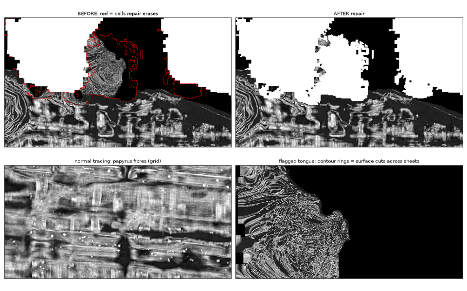

# CT 로 본 v14 이음새 — 수리 전후

`render_seam.py` 가 v14(PHercParis4 20230702185753, 2.4 um tifxyz)의 이음새 구간(격자 300~640줄)을 레벨 2(9.6 um) CT 로
렌더링한다. tifxyz 격자가 이미 펼친 좌표라 평탄화 계산 없이 격자를 4배로 보간하고, 점마다 법선 방향 ±6 vx 를 읽는다.
CT 조각 2,912개(새로 받은 1,677개) 22분, 렌더 33초.

- 제대로 추적된 곳: 파피루스 섬유가 가로세로 격자로 보인다.
- 수리가 지운 칸(빨간 선 안): 섬유 대신 등고선 같은 고리 무늬 — 표면이 장을 비스듬히 뚫고 지나간 자리. 수리 뒤 거의 다 사라진다.

층 일관성(`../switchbench/coherence.py`): 층 0 과 ±2 vx 층의 국소 상관. 장 위에서는 낮고(섬유 0.27 / 0.31),
장을 가로지르면 높다(지운 칸 0.76, 같은 표면의 깃발 없는 고리 구간 0.71 — seamcheck 가 놓친 곳).
SwitchBench 사건 점 단위로는 약하다(v0: 사건 중앙값 0.52, 무전환 0.42, 같은 5×5 창) — 점 탐지기로는 못 쓰고, 넓은 장 건너뜀 영역을
찾는 데 쓴다. 다음: v14 전체와 다른 깃발 조각으로 넓히기.
